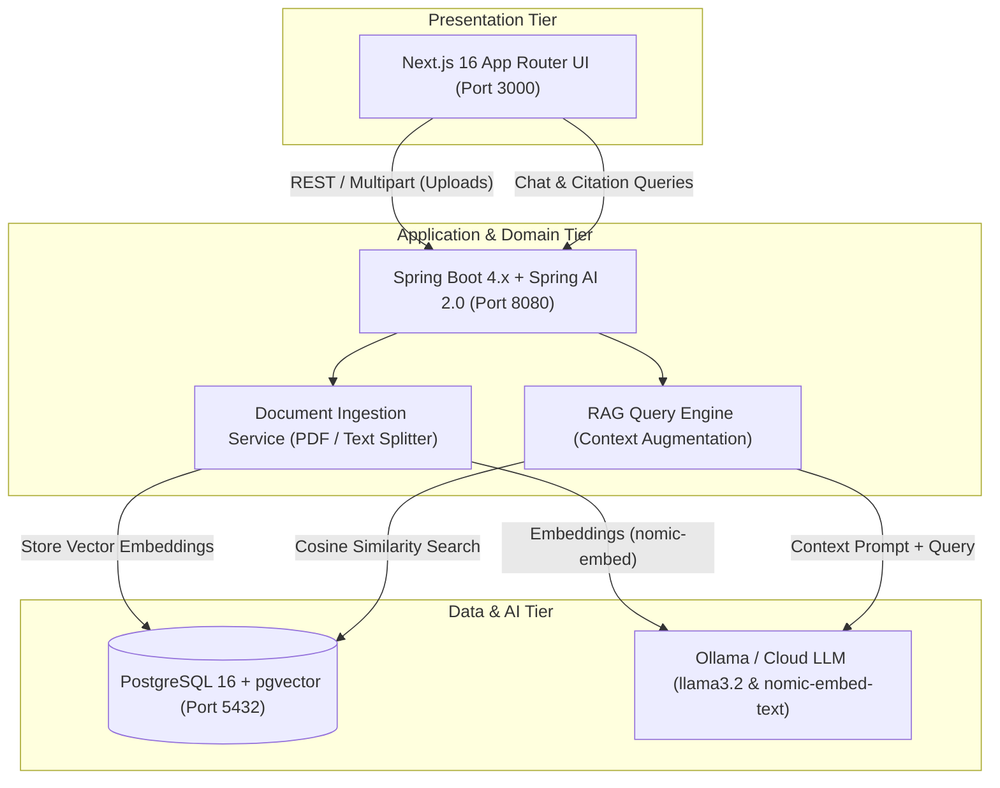

# 🚀 Enterprise Knowledge-Base Search Engine (RAG Stack)

[](https://github.com/SupunNethsara/enterprise-rag-engine/actions/workflows/deploy.yml)
[](https://spring.io/projects/spring-boot)
[](https://spring.io/projects/spring-ai)
[](https://nextjs.org/)
[](https://github.com/pgvector/pgvector)
[](https://www.docker.com/)
[](https://aws.amazon.com/ec2/)

An enterprise-grade, privacy-first Retrieval-Augmented Generation (RAG) platform designed to transform unstructured business documents into an intelligent, queryable knowledge base. Built using a robust microservices-ready architecture, this system combines high-performance backend processing with vector-based semantic search to deliver accurate, hallucination-free AI responses.

---

## 🏛️ System Architecture



---

## 🛠️ Tech Stack & Key Highlights

- 📄 **Intelligent Document Processing:** Automated PDF/text parsing, token-based semantic chunking (`TokenTextSplitter`), and metadata tagging.
- 🔍 **Vector-Based Semantic Search:** Powered by PostgreSQL with `pgvector` extension and HNSW indexing for rapid cosine similarity matching.
- ⚡ **Spring AI Integration:** Clean abstraction for `VectorStore`, `ChatModel`, and `EmbeddingModel`.
- 🧠 **Local LLM Orchestration:** Powered by Ollama (`llama3.2` and `nomic-embed-text`) with hardware GPU acceleration.
- 🔒 **Enterprise Clean Architecture:** Organized into `domain`, `application`, and `presentation` layers.
- 🎨 **Modern Frontend:** Next.js 16 App Router, TypeScript, Tailwind CSS, and interactive citation badges.
- 🐳 **Multi-Stage Dockerization:** Ultra-lightweight container images (~200MB Backend JRE, ~120MB Next.js Standalone).
- 🔄 **Automated CI/CD:** GitHub Actions pipeline with automated testing, verification, and zero-downtime deployment to AWS EC2.

---

## 🚀 Running Locally

### 1. Start Database & AI Models
```bash
# Start PostgreSQL pgvector
docker compose up -d

# Start Ollama models (if using local AI)
ollama pull nomic-embed-text
ollama pull llama3.2
```

### 2. Start Backend
```bash
cd backend
./mvnw spring-boot:run
```

### 3. Start Frontend
```bash
cd frontend
npm run dev
```

Visit [http://localhost:3000](http://localhost:3000) to access the UI.

---

## 🚢 Production Deployment (AWS EC2)

Deploy the entire stack in one command on any Docker-enabled host:

```bash
docker compose -f docker-compose.prod.yml up --build -d
```
